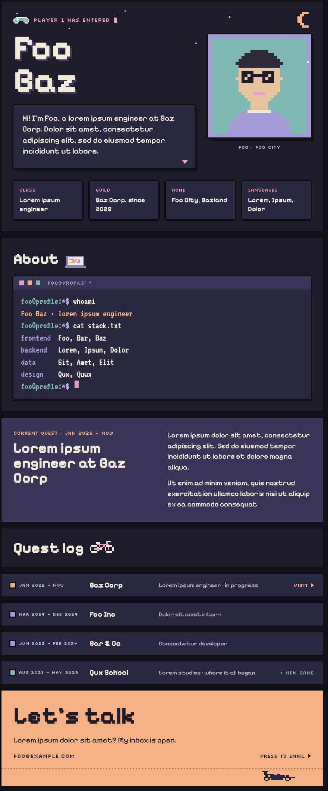

# profile-builder

Turn one JSON file into a pixel-art, lofi-styled GitHub profile README, with a pixelated portrait, a terminal "About", a quest log of your jobs and small 8-bit animations.

<p align="center"></p>

## Why it works on GitHub

GitHub strips all CSS from a README, so a styled page normally turns into plain text. profile-builder renders each section as its own SVG "card", with HTML inside `<foreignObject>` and the fonts and portrait embedded. GitHub shows SVGs as images, so the design survives, and every card is wrapped in a real link so it stays clickable.

You get:

- A hero card with your name, a typing intro and a pixelated portrait made from any photo
- An About card styled as a terminal (`whoami`, `cat stack.txt`)
- An optional current-job card that drops out when `"job": null`
- A quest log with one card per job or school, each optionally a link
- A "Let's talk" card that opens an email, and top buttons for repos, LinkedIn and email
- Twinkling stars, a blinking cursor, rows sliding in and an F1 car driving past. Everything stays readable if animations are off or the viewer prefers reduced motion
- A collapsible plain-text version for screen readers and search

## Requirements

- Python 3.8 or newer. No packages to install.
- Google Chrome or Chromium. It runs headless to measure each card. Set `CHROME=/path/to/chrome` if it isn't found automatically.

## Quick start

1. Clone this repo.
   ```bash
   git clone https://github.com/ledei/profile-builder.git
   cd profile-builder
   ```
2. Edit `profile.json` with your own details (see the reference below).
3. Put a square-ish PNG photo in the repo, for example `me.png`, and point `"portrait"` at it.
4. Build.
   ```bash
   python3 build.py
   ```
   This writes `output/README.md` and `output/assets/`. Open `output/preview.html` in a browser to check every card.
5. Copy `README.md` and `assets/` into your profile repo, the special repo named after your username (`your-username/your-username`), then commit and push.

To build straight into your profile repo instead:

```bash
python3 build.py --out ../your-username
```

## profile.json reference

| Field | What it does |
| --- | --- |
| `name` | Shown big in the hero, split over two lines at the first space |
| `first_name` | Used under the portrait |
| `handle` | The terminal prompt, as in `handle@profile` |
| `role` | The Class stat and the `whoami` line |
| `home` | The Home stat. The part before the first comma also goes under the portrait |
| `languages` | The Languages stat |
| `intro` | The text that types out in the hero. `{at_job}` becomes " at Company", or disappears when there's no job |
| `portrait` | Path to a PNG, relative to `profile.json` |
| `pixelate` | Pixel grid for the portrait (64 by default). Use `0` to keep the image as it is |
| `job` | `company`, `url`, `since`, `period`, `title` and `text` (a list of paragraphs). Set to `null` to hide the card |
| `stack` | Groups of tools. Each key becomes a line in `cat stack.txt` |
| `quest_log` | Rows with `when`, `where`, `what`. Optional: `url` (makes the row a link), `current: true` (highlights it), `tag` (a small label like "New game") |
| `links` | `github` (your username), plus optional `email` and `linkedin`. Leave one out to drop its button |
| `texts` | Optional overrides for every UI label, to translate or reword them (see the `T` defaults at the top of `build.py`) |

## Common changes

- **New job:** update `job`, add a row at the top of `quest_log` with `"current": true`, and remove `current` from the old row.
- **Between jobs:** set `"job": null`. The job card goes away, and the Guild stat shows "Open to new quests".
- **Another language:** override the labels under `texts`, for example `"talk_title": "Hör av dig"`.
- **Colours:** the palette is defined near the top of `build.py`.
- **Sprites:** the pixel art (controller, laptop, BMX, F1 car) is drawn as text grids in `sprites.py`.

## Good to know

- Each card is an image, so on a phone it scales down with the screen and small text gets smaller. The text version at the bottom keeps everything readable.
- GitHub caches images for a few minutes. If a change doesn't show right away, wait a moment or hard-refresh.
- Cards without their own link point to your profile, so a click doesn't open the raw SVG.

## Licence

The code is MIT, see `LICENSE`. The fonts in `fonts/` (Pixelify Sans, Silkscreen and VT323) are licensed under the SIL Open Font License 1.1; their licence files sit next to them.
